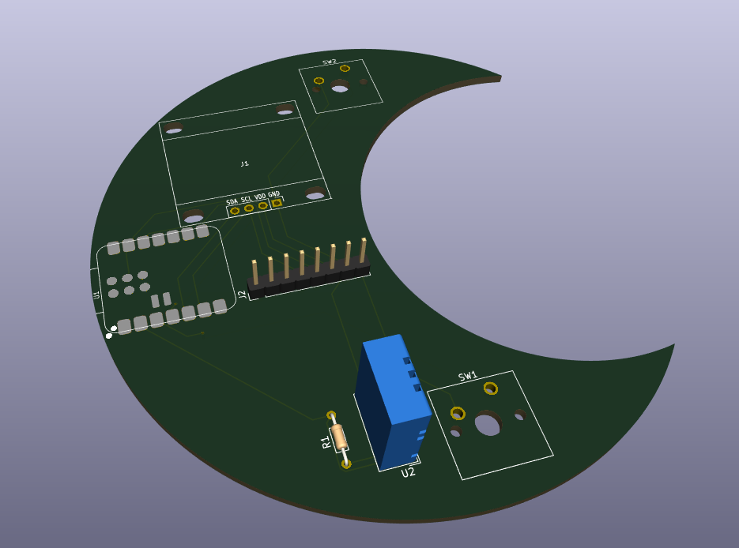
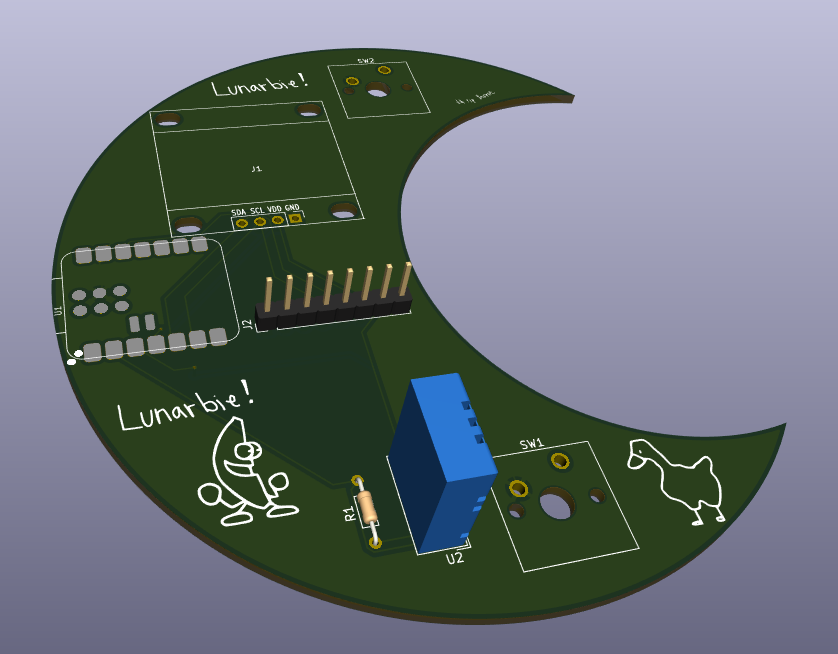
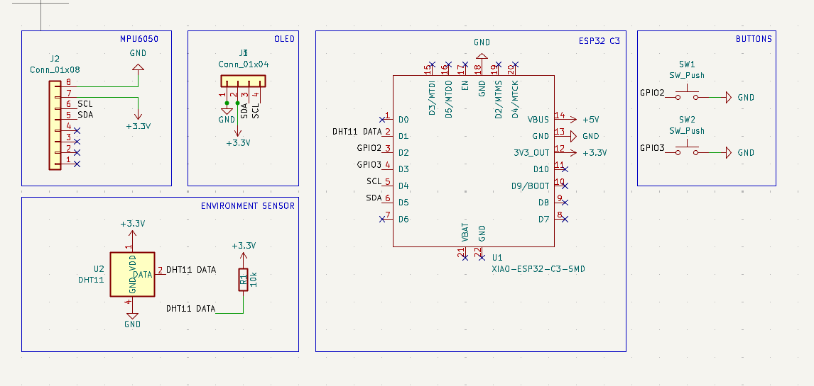
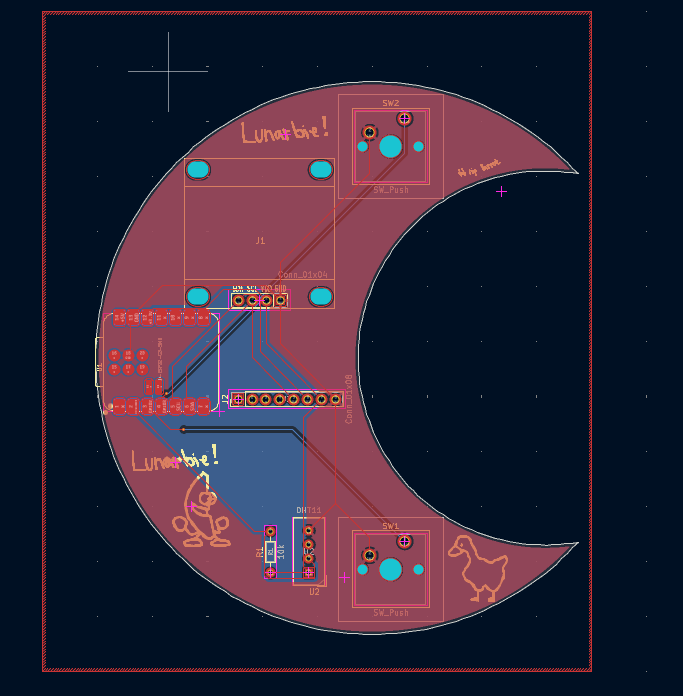
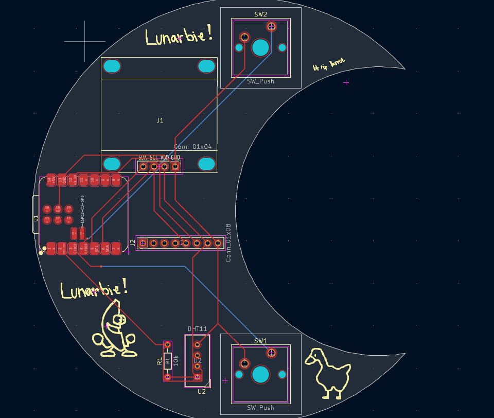

# Lunarbie

The nighty companion of Starbie! Lunarbie is a tiny keychain sized board that acts like a little pet for your everyday carry.It is the counterpart to Starbie a starter project of the Hackclub Half-Life program

Heavily inspired by this Repo: [have a look](https://github.com/SharKingStudios/Starbie/tree/main)

# What is this

Lunarbie is a project, made for the [Half life](https://halflife.hackclub.com) by Hackclub programm. It is an alternation by earlier mentioned beginner project Starbie. The project itself is a tiny keychain sized board that acts like a pokemon styled pet. 

The Board features a Microcontroller, display, motion sensor, and environmental sensor in a compact PCB design. It is USB powered and easy to build. Its also moon shaped !

# Project status

The project is finished but it is still possible that some additions to this repo will be made, like CAD files or more features for the Lunarbie.

# Detailed description

Lunarbie is able to interact with its holder passively with its environmental and motion sensors or via the buttons on it. It can interact with the holder by changing its built in display. 
(Additionally it is able to detect another Lunarbie (or Starbie) when holding them at each other, similar to apples airdrop feature.)

# Motivation

The main motivation is of course the Half Life (LINK) program by hackclub. It was designed in week one of the project where the task was to create a custom PCB. Other than that, I really wanted to design a PCB for a long time now and it definitely won’t be my last one. It was really fun to design it and challenge me with a fun and beginnerfriendly project that could maybe even be continued.

# Project journaling

Via the [Half life](https://halflife.hackclub.com) by Hackclub programm, several Journal entries have been made either in timelaps form or as written entry to track the project. 

# Assembly

The assembly should be quite beginnerfriendly. The board itself has not many part and is partly prefabricated. All remaining components are easy to be soldered by hand.

# Schematic and components

The board is powered by the XIAO_ESP32C3. It provides the power and data connector with an onboard USB-receptacle. The board also features a MPU6050 motion sensor and an DHT11 environmental sensor. Furthermore it has an Display to broadcast emotions and expressions of the pet. For navigation of the Display and its features, there are two buttons on the board.

# PCB

The PCB is a simple 2 layer PCB with another silkscreen layer for cosmetic purposes. The board also has a GND pour and features routing on the front and backside.

closeup

# Firmware

The firmware is written in the ArduinoIDE and is contained in one singe .ino file. It has some additional features but mainly comes from the starbie repo mentioned above. The firmware can be easily flashed onto the ESP as long as the board has been downloaded in the IDE.

# BOM
The BOM can be viewed in the [BOM.md](BOM.md) file 
